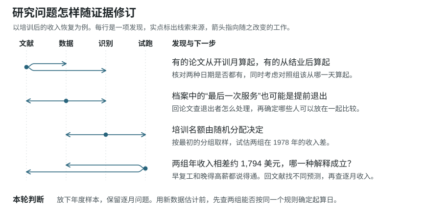

# 经济学选题可行性验证

一个经济学想法，值得花半年做下去吗？把你观察到的现象交给 Codex，即使还没定下因变量，也可以开始。这个 Skill 从最接近的论文入手，一边读一边看真实数据能测到什么、哪些人可以比较。它会随着发现收窄问题，在值得投入的地方做一次小规模实证。你会得到一份 `选题判断.md`，第一句写明**继续做、暂缓，还是停止**，后面附上得出判断的证据。

一次试跑问的是，失业者培训结束后，收入在第几个月恢复？在 445 人的随机实验样本里，培训组的年收入比对照组平均高约 1,794 美元。但一个人很快就复工，另一个人半年后才找到工资更高的工作，两人的年收入可能一样。这次的决定是**保留问题，换一套能看到逐月收入的数据**。另一套档案确实能把参加者的服务结束日期和逐月收入接起来。剩下的难题是，对照组该从哪一天算起？[查看选题判断、Stata 代码和实际结果](examples/training-income/)

## 文献、数据、识别和试跑怎样交错

先读最可能已经回答这个问题的论文。读到一个关键日期，当场就可以翻问卷、看几行记录。反过来，数据里一条意外的分组规则，也可能改变对照组的选法，还会提示该重新检索哪一批论文。等到能说清比前人多回答了什么，再投入大规模取数和主回归。哪一轮的证据够了，就在哪一轮作决定。

<picture>
  <source media="(max-width: 600px)" srcset="figures/research-workflow-mobile.svg">
  
</picture>

一次试跑即使得到预期的正系数，也可能让问题更值得改。比如，更早复工和更晚找到高薪工作都能提高年收入，光看这个系数就分不清两种解释。此时要回文献找它们在哪个月份给出不同预测，再决定取什么数据。每次改题或改比较方法，Agent 都会记下是哪条证据促成了修改，并保留先前的估计。

- **查撞题会读到原文。** 从中英文关键词、相同机制的其他叫法、参考文献和后续研究找到最接近的几篇，指出具体哪张表或哪个理论命题已经回答了什么。如果想换个地区再做一次，就要解释当地的制度差异会改变哪条经济学结论。
- **先核实能不能比较，再选方法。** Agent 会打开样本，看关键变量到底记录了谁、何时发生、两份数据能否接上。做因果研究时，它会参考同类经济学论文，核实处理如何分配、谁能充当对照。需要估计时优先用 Stata MCP，并留下可重跑的脚本。
- **不显著也要读出分量。** 假如理论预言就业率至少提高 2 个百分点，一个足够窄的置信区间可以排除这条预测。若区间宽到连方向都分不清，下一步就看能不能以合理成本增加有效样本。两种情况都可能让人停手，理由却不同。

## 在 Codex 中使用

在你准备做研究的项目目录运行下面这条命令，把 Skill 安装到当前项目。

```sh
git clone https://github.com/mimaowang/econ-idea-feasibility.git .agents/skills/econ-idea-feasibility
```

打开这个项目，在 Codex 中写下你想验证的问题。一段话就够。

> $econ-idea-feasibility 我想知道，失业者培训结束后，收入要几个月才能恢复。我现在只有这个想法，能用公开数据。请帮我判断值不值得继续做。

也可以附上已有论文、数据字典、回归结果或时间预算。Agent 会在研究项目下新建选题目录，保存判断、数据出处和实际运行的结果。检索和取数使用当前环境可访问的来源。回归优先使用已连接的 Stata MCP，也可以使用本机 Stata，或实现同一估计的 R、Python。[Codex 的 Skill 安装位置](https://learn.chatgpt.com/docs/build-skills#where-codex-loads-local-skills)

## 参考项目

中英文检索和文献查重借鉴了 [econ_idea_workflow](https://github.com/ilearn574680-stack/econ_idea_workflow) 与 [research-topic-skill](https://github.com/MartyYao/research-topic-skill)。实际试跑、估计前记录主规格，以及遇到问题时退回相应步骤，借鉴了 [topic-feasibility-screener](https://github.com/lzh-phd/topic-feasibility-screener) 与 [Paper-WorkFlow](https://github.com/brycewang-stanford/Paper-WorkFlow)。

本仓库编写的 Skill、文档和代码采用 [MIT 许可证](LICENSE)。示例数据的出处与使用条件见[案例说明](examples/training-income/)。
